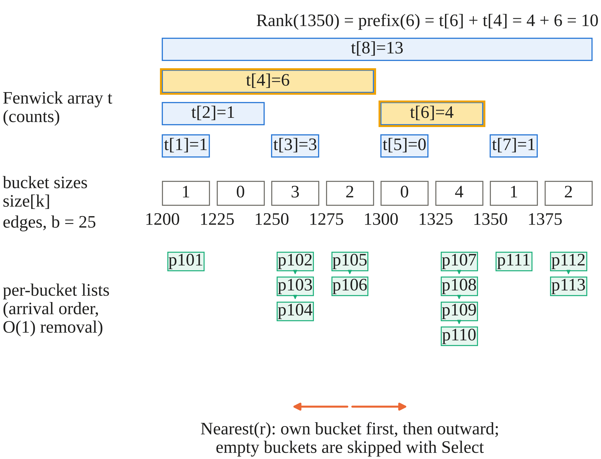
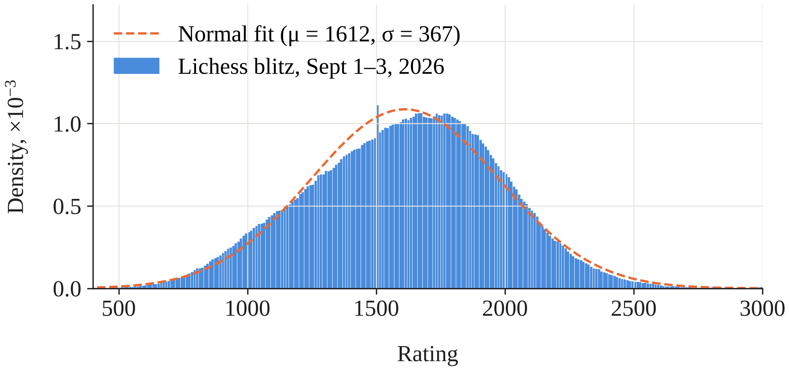
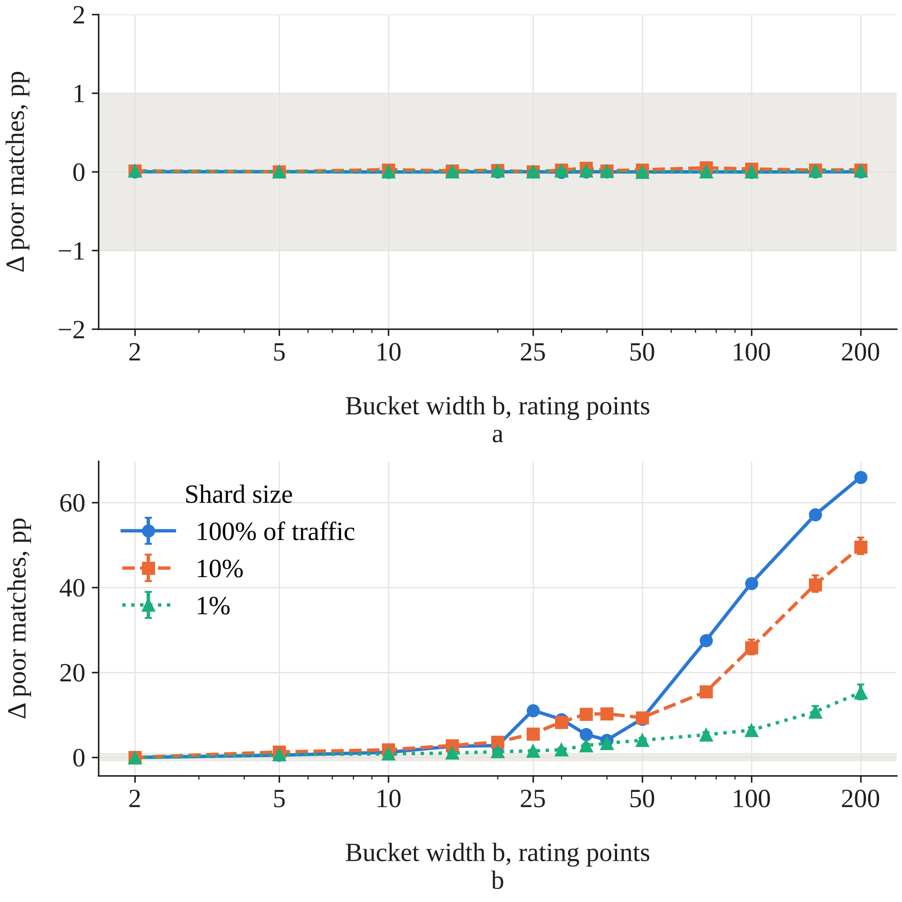
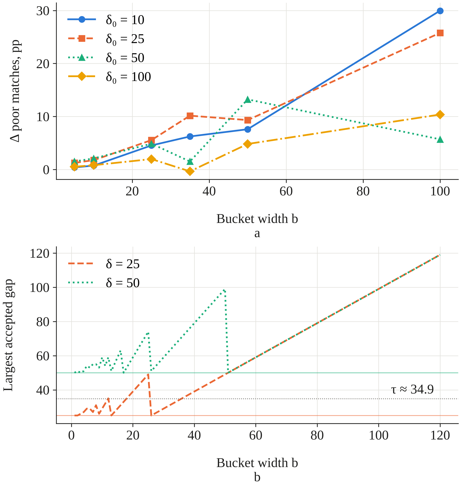
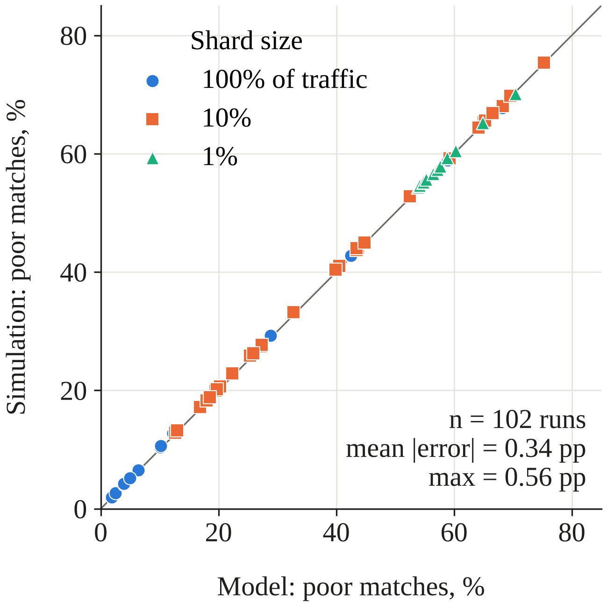
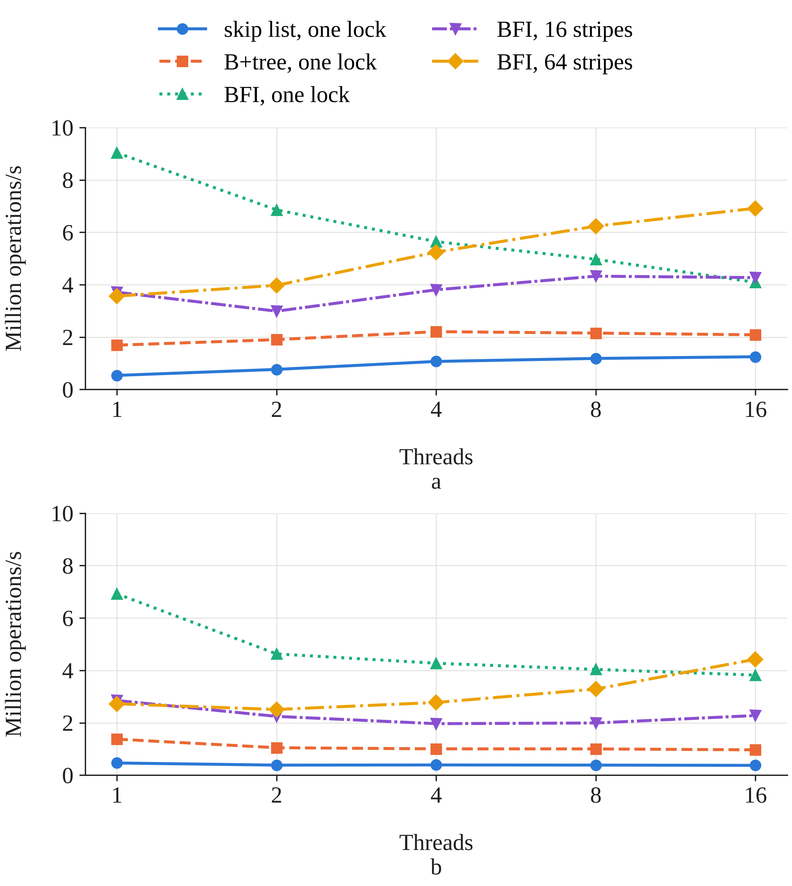

# Індекс Фенвіка з кошиками для черг підбору гравців за рейтингом: межі застосовності та ціна квантування рейтингу

Іван Фекете

## Анотація

Об'єктом дослідження є індекс у пам'яті для черги підбору гравців за рівнем майстерності. Проблема задачі полягає в тому, що загальні впорядковані множини відповідають на запити черги за час, який зростає з кількістю гравців в очікуванні. Одним із можливих рішень є квантування рейтингів у кошики, що зменшує час роботи, але може погіршити якість матчів. Визначено індекс Фенвіка з кошиками для вставки, видалення, рангу, підрахунку в діапазоні та переліку k найближчих гравців і порівняно його з альтернативами на основі порівнянь і на основі домену рейтингів. На рейтингах із бліц-партій Lichess індекс відповідає на запит рангу за 26 нс і на підрахунок у діапазоні за 60 нс для 10^6 гравців незалежно від розміру черги. Це у 2,5–2,8 рази швидше за кореневу декомпозицію, в 11–12 разів швидше за B+-дерево порядкових статистик і більш ніж у 40 разів швидше за список із пропусками. Це пояснюється тим, що робочий набір даних розміщується в L1-кеші (кеші першого рівня процесора). Квантування не змінює якості підбору гравців, якщо різниця в рейтингах перевіряється за точними значеннями: усі 132 конфігурації еквівалентні точному підбору в межах 1 процентного пункту. За перевірки на рівні кошиків частка поганих підборів зросла до 66 процентних пунктів; аналітична модель передбачає це з похибкою до 0,56 процентного пункту. Індекс поступається альтернативам, коли оновлення становлять понад 50–75% операцій, коли на кошик у середньому припадає значно менше одного гравця і коли черга спільна для потоків під одним м'ютексом (для паралельної роботи чергу слід розділяти на незалежні частини). Результати можна використати для проєктування сервісів підбору гравців і оптимізації наявних систем підбору.

Ключові слова: підбір гравців, дерево Фенвіка, двійкове індексоване дерево, порядкові статистики, квантування рейтингу, онлайн-ігри, структури даних, кеш процесора.

# A bucketed Fenwick index for skill-based matchmaking queues: operating envelope and the cost of rating quantization

Ivan Fekete

## Abstract

The object of the study is the in-memory index of a skill-based matchmaking queue. The problem is that general ordered sets answer queue queries in time that grows with the number of waiting players. One of the possible solutions in this case is quantizing ratings into buckets, which reduces runtime but may harm match quality. The bucketed Fenwick index is a data structure that is defined for insertion, removal, rank, range count, and k-nearest enumeration and is compared with comparison-based and domain-based alternatives. With ratings drawn from Lichess blitz games, the data structure answers rank queries in 26 ns and range count queries in 60 ns for 10^6 players, regardless of queue size. This is 2.5-2.8 times faster than square-root decomposition, 11-12 times faster than an order-statistic B+tree, and more than 40 times faster than a skip list. These results can be explained by the fact that the working set stays in the first-level (L1) cache. Match quality remains unaffected by rating quantization when windowing is applied to exact ratings: all 132 cases are equivalent to exact match within 1 percentage point. In case of bucket-level windowing, the number of poor matches increased by up to 66 percentage points, and a closed-form model approximates this increase within 0.56 percentage points. The index performs worse than alternatives in cases when the amount of updates exceeds 50–75% of operations, when buckets contain much less than one player on average, and when a queue is shared between threads and blocked by a mutex (sharding is preferred over mutex for parallel execution). The results can be used to design matchmaking services and optimize the work of existing matching engines.

Keywords: matchmaking, Fenwick tree, binary indexed tree, order statistics, rating quantization, online games, data structures, CPU cache.

## 1. Introduction

Online games with competitive modes match players of similar skill. A matchmaking service adds players who send a request to be added to a game to a queue and repeatedly searches it for opponents whose ratings lie within a window around each player's rating. The window size is increasing for every next iteration until the match is found. Each player is inserted and removed once but is queried in every matching round, which means that queues are read-heavy. These queries may have the following types: how many players there are in a specific rating range, what is the rank of a rating among the queued players, and which players are the closest to a given rating value. As a large matchmaking engine runs many such queues at the same time, the latency of these queries limits how often the matchmaker can run and how many queues one server can hold. For example, on 1–3 September 2026 Lichess alone started on average about 955 rated blitz games, that is, about 1,900 queue arrivals, per minute (Section 4.2).

In practice, the queue is usually stored as a general-purpose ordered set, such as the skip list behind the sorted sets of Redis, or in a set of rating buckets that are scanned linearly. The first data structure answers every query with a logarithmic time complexity in the number of players but has a high memory access constant due to central processing unit (CPU) cache misses; the second is more cache-friendly and fast to update (constant time) but slow to count (linear time in the number of buckets). Both of these options don't take into account the fact that rating values may belong to a small, limited range of numbers, and this constraint allows counting over the rating domain instead of over the players. These ranges also may be coarsened into buckets, which makes such structures even smaller and helps them fit into the first-, second- or third-level (L1/L2/L3) processor cache. To our knowledge, this issue was never addressed in previous studies, and therefore this study seeks to close this gap.

In this study, a Fenwick tree, which contains information about rating bucket sizes and player lists for every bucket, is used as a basis for the matchmaking queue, and the analysis of its efficiency in comparison with other methods is provided for the server. The findings of this study can be interesting for engineers designing and maintaining matchmaking services, as well as in all cases when counting trees can be used instead of sorted sets.

## 2. Literature review and problem statement

The Fenwick tree (also called a binary indexed tree) provides logarithmic time updates and queries for prefix sum structures for a counters array [1]. Follow-up papers researched the compact implementations of this structure and its rank and select functions, and demonstrated that aside from the algorithmic complexity, one of the key aspects that speeds up the data structure is its memory layout [2]. In both papers, the structure is examined in isolation from the application; thus, no workload in which each counter belongs to the list of entities that should be enumerated is considered, and no coarsening of the counter domain is taken into account.

Comparison-based structures perform rank operations based on the values and don't require any limitations on rating values to store them. The skip list [3] is used as the backend of the Redis sorted set structure and is frequently used for the leaderboards and queues in game servers. The order-statistic search trees and the B-trees with per-node counts [4] provide the same functionality with deterministic bounds. The cost of their operation increases logarithmically with the number of entities, and on the current generation of processors the main overhead comes from the cache misses due to the pointer-chasing problem that happens because each node is allocated separately in a different area of memory, which does not allow efficient memory caching on the CPU side. However, there are array layouts that improve search locality [5], while recently there has been a locality-optimized B-skiplist [6] designed to solve the problem, but it does come at a cost of complexity, raising the question of if there isn’t a simpler way around it.

Concurrent rank queries make things even more complicated. Although optimistic concurrent skip lists allow for fast insertion and search operations without rank operations [7], lock-free augmented trees support subtree size management operations [8]. Both solutions are designed to be generally applicable and, except for the trie variant of [8], do not take any benefit of domain boundedness, while their performance comparison with domain-based sharding under coarse locking has not yet been done for queues.

Research papers on matchmaking are mainly concerned with rating models and matchmaking procedures. Rating systems like Elo, Glicko [9], TrueSkill [10], and Elo-MMR [11] evaluate players' skills according to the outcomes and calculate the probability of victory that defines the level of match quality. The matching policy aims at maximizing the probability of winning the target, engagement [12], team formation [13, 14], or the matching success rate under a waiting-time trade-off [15]. Delayed online matching considers the compromise between waiting and match costs [16]. Studies measuring games in production mention the conflict between waiting and match quality [17]. Latency-aware matchmaking considers the network latency instead of player skill [18, 19]. None of these research papers specifies or evaluates the in-memory index used by the pairing policy to select the candidates.

In some systems, the index may consist of buckets that rate different items: tickets in open-source matchmaking frameworks are bucketed by attribute ranges [20]. The latest preprint proposes to use non-uniform buckets to represent discrete ratings [21]. Although the discretization process limits the size of the key domain just like quantization does, it modifies the list of candidates that the matchmaker queries first. Approximate quantile summaries [22, 23] are similar in terms of trading space for accuracy; however, they neither support deleting a certain entity nor listing entities within the specified range. These operations must be possible with matchmaking queue implementation.

Therefore, there is enough information in the literature regarding prefix-sum data structures, order sets, rating models, and pairing policies, but there are two questions left unanswered for skill-based matchmaking queues: how a bounded-domain index is compared to comparison-based indexes and other bounded-domain structures in all operations, and how quantization affects the matching performance. This determines the problem addressed in this study.

## 3. The aim and objectives of the study

The aim of the study is to find the operating range of the bucketed Fenwick index for skill-based matchmaking queues and quantify the impact of the ratings quantization on the match quality. As a result of this research, it should be possible to determine the queue type and the bucket size for a matchmaking system based on the tickets’ arrival rate and the expected shard size.

In order to achieve the aim, the following objectives were defined:

– to define the bucketed Fenwick index in the context of all queue operations (insertion, deletion, ranking, range counts, and enumeration of k nearest players) and evaluate their time and space cost;

– to evaluate the index latency, memory, and cache behaviour compared to alternatives;

– to investigate the impact of bucket size on the match quality and wait time with respect to the empirical arrival pattern and position of the matchmaking process in the rating range, and develop an analytic model of the process;

– to find edge cases where the bucketed Fenwick index doesn’t have an advantage; potential cases are heavy writes, sparse rating range, or multithreaded memory access.

## 4. Materials and methods

### 4.1. Object, hypothesis and assumptions

The object of our study is the in-memory index of the matchmaking queue containing the players who wait for a match in one shard (partitioning of the players' population based on geographical location, game mode, or other relevant characteristics). The main hypothesis we are going to test is that in the case of a limited integer space of ratings, the index whose cost depends on the number of rating buckets, not on the number of players in the queue, will outperform the comparison-based data structure.

Assumptions of the study are as follows. The ratings in the database are known integers in the range [0, 3500), which is an upper bound on ratings in Lichess (the minimum and maximum rating values in our data are 400 and 3197, respectively). The index is in-process, single-shard, and ephemeral; persistence, replication, and global leaderboards are out of scope. Match quality is defined via the logistic Elo model: p= 1 / (1+10^(−Δ/400)), where Δ is a rating gap between two players; the match is called a poor one if p lies outside the interval [0.45, 0.55], i.e., when |Δ|>τ≈400·log10(0.55/0.45)≈34.9 rating points.

The simplifications made here are:

 - The joining times of the queue are not available publicly; instead, the starting time of the played game serves as the joining time for both players.

 - The one-versus-one matching is considered; teams are not formed.

### 4.2. Data

For rating distribution and the arrival process, we have chosen data from the Lichess open database [24] for rated games played on 1–3 September 2026 (Coordinated Universal Time, UTC): 8,954,768 games, including 4,127,086 blitz games. For our experiment, only the necessary header fields (start time, time control, and both ratings) were extracted from the dump.

Blitz is utilized as the primary workload throughout, as it represents the biggest workload.

### 4.3. The index and the alternatives

Bucketed Fenwick index (BFI) maps rating r to the bucket with number ⌊(r − r_min)/b⌋ (numbered starting from 0), with bucket width b over the B = ⌈D/b⌉ buckets, where D is the width of the rating domain. The index maintains two data structures per bucket: the Fenwick tree for player counts and the list of the players for every bucket (Section 5.1). For testing, we implemented two list layouts: an intrusive doubly-linked list residing on a node pool, maintaining arrival order inside the bucket and allowing O(1) removal of the player via handle and slice of items with swap-and-pop removal. The second option saves memory compared to a linked list but partially loses arrival order. In order to measure the effect of the Fenwick tree, the same bucket lists have also been tried with a flat array of counts (linear prefix sums), two-level square root decomposition of the counts, and without any count index; the latter variant corresponds to a plain bucketed pool of the kind employed in matchmaking frameworks [20].

As alternatives to comparison-based solutions, we selected a sorted array (rating, id), a skip list with span counters same as Redis Sorted Set [3], order statistic treap with subtree sizes, order statistic B+ tree with per-child count and fanout of 32 [4]. All structures implement the same interface (insert, remove, rank, range count, k nearest) and are implemented in Go 1.24.

In the concurrency experiment (Section 5.4), each data structure is guarded by one reader-writer lock (Go sync.RWMutex). For queries, this lock is shared, while for updates, the lock is exclusive. Also, BFI is divided into S ∈ {16, 64} contiguous rating stripes, which follow bucket boundaries. All stripes are BFI structures in themselves and have an independent lock and an atomic counter for players. Every transaction is linearizable relative to one of the stripes, but a multi-stripe query does not lock the stripes' counters when reading from them, meaning that the values retrieved are only valid relative to each stripe during some part of the transaction.

The correctness of each structure is tested using property-based tests, which means that very long chains of operations are performed with the structure and also with the reference solution, and these results are checked against each other. If the bucket size b > 1, the reference works with bucketed ratings to make sure the test checks the implementation instead of the quantization algorithm. We also added tests to catch any problems in the tie-breaking mechanism and the Fenwick select procedure by introducing intentional off-by-one faults into the program.

### 4.4. Queue simulation

To evaluate how much quantization affects match quality, the arrival sequence was replayed through a matchmaking system implemented with the help of BFI. The matchmaker implements the typical widening-window approach, according to which the waiting time of a player equals w seconds, and he/she is ready to play against an opponent whose score differs by no more than δ(w) = min(400, δ0 + g·w), where δ0 = 25 and g = 5 points/second by default. Every newcomer makes a match attempt; every second, the matchmaker considers all waiting candidates in descending order of their waiting time. A player in wait state that is not matched in 300 seconds is deleted from the waiting list. Generation of candidates happens depending on the index only: Nearest(r, k) (where k = 16) gives k players waiting based on the bucket distance in ascending order. Two methods were used to select the candidate: the first acceptable candidate selected from among those candidates created and the candidate with the minimum real rating difference.

The two possibilities were compared where the window check takes place. In the first variant, the acceptance criterion is applied based on the real ratings of the two players, which are stored by the matchmaker along with the index. In the second one, the acceptance criterion is checked using only bucket indices: two players are acceptable if the product of their bucket distance and b does not exceed the width of the window, which is what the matchmaker would do if the index were the only representation of a rating that it uses.

The sizes of shards were determined by accepting each game with probability s ∈ {1, 0.1, 0.01} that makes the arrival rate variable but preserves the ratings distribution and arrival rates per day. Due to the fact that games on Lichess are matched by its own matching system, the ratings of players are highly correlated. In this way, replaying them the same way will make the simulation imitate the matching process on Lichess. However, since we do not need to imitate this process, it is required to shuffle the ratings of players randomly among all arrivals in one hour. The reason for this adjustment of the algorithm is that in the previous versions of the simulation, the pairs in buckets were formed very closely, which is why all further results were obtained using adjusted replay.

### 4.5. Statistical analysis

For each configuration the simulation keeps track of, per hour, the number of matches, the number of bad matches (|Δ| > τ), waiting times, and the number of abandonments. The impact of the bucket width b is the average of the paired difference in the ratio of bad matches between b and b = 1, over 72 hours, under otherwise the same conditions. Equivalence under b = 1 was assessed by applying the two one-sided tests approach [25, 26] at α = 0.05, with a fixed equivalence margin of 1 percentage point (pp); alternatively, the 90% confidence interval for the mean difference must fall into the interval (−1, 1) pp. Successive hours are dependent; hence a moving block bootstrap approach was used, with a block size of 6 hours and 4,000 replications. Sensitivity analysis on the parameters of the matchmaker was conducted for each parameter separately: δ0 ∈ {10, 25, 50, 100}, g ∈ {2, 10}, and k ∈ {4, 64}.

Latency and memory usage have been tested on a dedicated bare-metal machine (Amazon EC2 c7i.metal-24xl: one socket of Intel Xeon Platinum 8488C CPU with 48 cores and 105 MiB of L3 cache) under Ubuntu 24.04 with Linux 7.0 and Go 1.24.7, according to recommendations on how to conduct thorough performance measurement [27–29]. Simultaneous multithreading (SMT) and frequency boost were disabled, the performance frequency governor was set up, transparent huge pages mode was set up to madvise, and all single-threaded benchmarks were pinned to a single core of the only non-uniform memory access (NUMA) node. The operations were measured using Go benchmarking framework on data structures filled with n ∈ {10^4, 10^5, 10^6} players with ratings from the empirical blitz distribution of Section 4.2; query ratings are also chosen from this distribution, whereas window sizes of range queries vary between ±25 and ±225 points. Each of the benchmark tests was run for 500 ms. The tests for isolation, mixed, and multithreading were performed 20 times with separate heap memory usage and hardware counter measurements. The presented value is the median of the values obtained from the repetition experiments with a 95% bootstrap confidence interval. The memory usage per player was calculated by means of the Go runtime heap statistics in steady state with n insertions and n removals. The statistics of hardware cache were measured using perf in Linux, where one process was dedicated to each operation and data structure combination, while the overhead incurred due to creation of the data structure was removed from the counter values, and the number of executed operations was estimated as the cycle count divided by the time per operation at the fixed 2.4 GHz frequency.

## 5. Results

### 5.1. Specification of the bucketed Fenwick index

The structure of the index is shown in Fig. 1. The Fenwick array t[1…B] contains in t[i] the number of players in buckets i−lowbit(i)+1…i, where lowbit(i) is the lowest bit in i. Besides, size[k] holds the number of players in bucket k, and each bucket contains a list of player identifiers (IDs). A hash map from player ID to list node (first-in, first-out (FIFO) layout) or to list position (swap structure) enables removal of the player by ID.

Fig. 1. Structure of the bucketed Fenwick index for eight buckets of width b = 25: Fenwick array of counts (top), bucket sizes, and per-bucket lists in arrival order (bottom). Yellow nodes indicate the prefix query performed in the call to Rank(1350)

The operations are the following:

– Insert(id, r): insert the player into the list of bucket k = ⌊(r − r_min)/b⌋, increment size[k], and increment by 1 the Fenwick tree at k; O(log B).

– Remove(id): locate the node using the hash table, unlink it in O(1) time, reduce the size[k] value, and increase the Fenwick tree by −1; O(log B).

– Rank(r): calculate the number of players in buckets from 0 to bucket(r) − 1; O(log B).

– RangeCount(lo, hi): calculate the difference between two prefix sums; O(log B). 

– Select(q): the bucket that contains the player of 0-based rank q found by descending the implied tree with binary lifting in a single pass; O(log B).

– Nearest(r, k): starting with bucket(r), collect k players by taking players from the nearest non-empty bucket below or above (whichever is lower on ties), in list order. The next non-empty bucket in either direction is found using a single prefix sum and a single Select in O(log B). The cost is O(k + m·log B), where m is the number of visited non-empty buckets.

Table 1 summarizes the costs and space requirements of BFI against the other structures. Domain-based data structures' operation costs are not affected by the number of waiting players n, while the comparison-based structures depend on log n and on the cache size of n nodes. In the case of b = 1, all domain-based structures provide exact answers to all queries.

Table 1. Cost of queue operations for the compared structures (n – waiting players; B – buckets; F = 32 – B+tree fanout; k – players returned; m – non-empty buckets visited; exp. – expected)

| Structure | Insert / Remove | Rank, RangeCount | Nearest(k) | Space beyond the ID map | Arrival order kept among equal ratings |
|---|---|---|---|---|---|
| Sorted array | O(n) | O(log n) | O(log n + k) | 16n B | no |
| Skip list with spans | O(log n) exp. | O(log n) exp. | O(log n + k) exp. | ≈77n B | no |
| Order-statistic treap | O(log n) exp. | O(log n) exp. | O(log n + k) with an iterator | 32n B | no |
| Order-statistic B+tree | O(F log_F n) | O(F log_F n) | O(F log_F n + k) | ≈16n B | no |
| Bucketed pool, no count index | O(1) | O(B) | O(k + B) | 4B B + lists | yes |
| Flat counts + lists | O(1) | O(B) | O(k + B) | 4B B + lists | yes |
| Sqrt decomposition + lists | O(1) | O(√B) | O(k + m·√B) | ≈4B B + lists | yes |
| BFI (Fenwick + lists) | O(log B) | O(log B) | O(k + m·log B) | 8B B + 24n B (FIFO) or 8n B (swap) | yes (FIFO layout) |

Quantization influences only which players will be returned for any given query; it does not affect the upper bounds on the cost (except possibly through B). Its influence on match quality is analyzed in Section 5.3.

### 5.2. Latency, memory and cache behaviour

The latency of individual operations is provided in Table 2. Among domain structures like BFI, the latency of operations is constant irrespective of the number of waiting players: The latency of the rank operation in BFI is 26.2 ns for n = 10^4, 10^5, and 10^6 players alike, whereas the latency of the skip list increases from 274 ns to 1,152 ns and that of the order-statistics B+ tree from 142 ns to 317 ns.

Table 2. Median latency of queue operations at n = 10^6 players, ns (95 % confidence interval in brackets; b = 1 unless stated)

| Structure | Rank | RangeCount | Nearest, k = 8 | Remove + insert |
|---|---|---|---|---|
| Sorted array | 218 [217; 218] | 458 [457; 458] | 238 [238; 238] | 149,195 at n = 10^5 |
| Skip list | 1,152 [1,149; 1,194] | 2,446 [2,436; 2,538] | 1,363 [1,360; 1,416] | 4,256 [4,240; 4,278] |
| Order-statistic treap | 429 [426; 459] | 907 [900; 981] | 2,650 [2,641; 2,692] | 3,466 [3,461; 3,812] 
| Order-statistic B+tree | 317 [316; 341] | 642 [640; 691] | 425 [424; 436] | 1,864 [1,862; 1,868] |
| Bucketed pool (no counts) | 1,166 [1,154; 1,176] | 1,756 [1,718; 1,768] | 46.7 [46.6; 55.8] | 305 [299; 311] |
| Flat counts + lists | 694 [693; 694] | 1,390 [1,390; 1,390] | 49.9 [49.8; 57.3] | 318 [314; 322] |
| Sqrt decomposition + lists | 72.5 [72.4; 72.6] | 152 [152; 152] | 46.3 [46.2; 54.7] | 323 [321; 328] |
| BFI, FIFO lists | 26.2 [26.1; 26.3] | 60.2 [60.1; 60.3] | 46.2 [46.2; 53.7] | 373 [370; 376] |
| BFI, swap lists | 26.3 [26.2; 26.3] | 60.0 [59.8; 60.2] | 20.8 [20.8; 20.9] | 358 [356; 363] |
| BFI, FIFO, b = 25 | 20.8 [20.7; 20.9] | 49.2 [49.0; 49.4] | 31.6 [31.4; 31.7] | 349 [348; 352] |

Compared to the fastest data structure of this type (square root decomposition), BFI is 2.8 times faster for ranking queries and 2.5 times for range counts; compared to the fastest comparison-based data structure (B+tree) – 12 and 11 times faster; and compared to the skip list – 44 and 41 times faster. In the case of k-nearest neighbor queries, the response time of all bucket-based data structures is about the same (46–50 ns): at this density, the query rarely leaves the bucket of the query rating and therefore does not use the count index. The response time of swap layout is twice as fast as FIFO (20.8 ns compared to 46.2 ns) due to its continuous memory scanning. This is the cost of keeping the order of arrivals within the bucket. The time taken to update the structures is 373 ns for BFI, and 305–323 ns for others with O(1) count updates; this difference between the two is 50–68 ns – the log Fenwick update. Most of the update cost of all structures is the hash-map access to map the player to its position, shared by all structures. The comparison-based structures need 1.9–4.3 μs per update at n = 10^6, and the sorted array needs 149 μs already at n = 10^5.

Increasing bucket size results in even lower latencies: for b = 25, the latency of a rank query is 20.8 ns, and for a k-nearest query, 31.6 ns, since there will be fewer buckets to traverse due to a smaller tree. The size of heap per waiting player for n = 10^6 players is 53.9 bytes for BFI with FIFO lists and 40.6 bytes for BFI with swap lists, in comparison with 61.8 bytes for treap, 99.2 bytes for the skip list, and 121.4 bytes for the B+tree (where B+tree uses a deletion algorithm that does not merge underfilled nodes; see Section 6). The arrays per bucket for the BFI algorithm with 3,500 buckets consume about 56 kB, which is insignificant for n = 10^6, as all other memory here is occupied by list nodes and the ID mapping.

Hardware counters are responsible for the latencies (see Table 3). This CPU can cache up to 105 MiB in the last-level cache; hence all data structures at n=10^6 have very rare last-level cache misses (up to 0.04 per query), while the rest is due to one and two levels closer to the core. A rank query of BFI experiences no L1 data-cache misses, no translation lookaside buffer (TLB) misses, and retires 2.4 instructions per cycle: the Fenwick tree of 14 kB fits in the L1 cache. Skip list generates 76 L1 cache misses, 17 L2 cache misses, and 16 TLB cache misses per rank operation; it retires 0.45 instructions per cycle. Treap and B+ tree rank operations are in between (L1 cache misses 36 and 21, and TLB cache misses 10 and 0.9, respectively). The count array has no cache misses at all; its only overhead is the number of instructions: it retires 4.9 instructions per cycle but performs 8,000 instructions per query. For updates, all structures pay for the identifier map (about 9 last-level accesses per BFI update); the comparison-based structures pay an additional cost of 35–78 last-level accesses and 14–58 TLB misses per update.

Table 3. Number of hardware events for each operation at n=10^6 (Rank query and remove + insert; IPC – instructions per cycle)

| Structure | Rank: IPC | Rank: L1 misses | Rank: L2 misses | Rank: TLB misses | Update: L1 misses | Update: L2 misses | Update: TLB misses |
|---|---|---|---|---|---|---|---|
| Sorted array | 0.62 | 33.0 | 10.7 | 2.4 | – | – | – |
| Skip list | 0.45 | 75.9 | 17.3 | 16.1 | 207.7 | 77.6 | 58.4 |
| Order-statistic treap | 0.55 | 35.9 | 1.3 | 10.0 | 130.5 | 37.6 | 51.1 |
| Order-statistic B+tree | 1.24 | 21.5 | 1.7 | 0.9 | 93.6 | 35.1 | 14.4 |
| Flat counts + lists | 4.91 | 0.0 | 0.0 | 0.0 | 23.3 | 9.3 | 5.3 |
| Sqrt decomposition + lists | 2.40 | 0.0 | 0.0 | 0.0 | 23.4 | 9.3 | 5.3 |
| BFI | 2.37 | 0.0 | 0.0 | 0.0 | 23.7 | 9.3 | 5.3 |

Note: L2 misses are counted as last-level-cache loads; per-operation values are obtained by subtracting a setup-only run and dividing by the number of operations executed (Section 4.5).

### 5.3. Effect of rating quantization on match quality

The rating distribution for the blitz workload is presented in Fig. 2. It is close to the normal distribution (mean 1612, standard deviation 367, skewness -0.08, excess kurtosis -0.19, Kolmogorov-Smirnov distance from the fitted normal 0.021); however, it has thinner tails: only 0.18% of ratings are three standard deviations away from the mean, in contrast to 0.27% for the normal distribution. The only noticeable deviation is a spike at the default rating of 1500, which holds 0.27% of ratings, about three times as many as its immediate neighbourhood. Arrival rates vary from 425 to 1,827 games per minute over the day, and the ratio between the busiest and the quietest hour of the day (totals over three days) is 2.65. The arrivals process is over-dispersed in relation to the Poisson one within one-hour intervals (median variance-to-mean ratio of arrivals rate per minute 1.58, 90th percentile 3.80). As for the real games played on Lichess, the median difference in rating is 30 points and 54% of matchups happen within τ.

Fig. 2. Distribution of blitz ratings in the Lichess games of 1-3 September 2026 with the fitted normal density

In the absence of rating quantization (b = 1), the fraction of bad matches becomes highly dependent on the shard size: 1.6%, 17.1%, and 53.6% for the whole arrival sequence, 10% and 1% of that, with median waiting times of 0, 1, and 9 seconds, respectively. The shard size, not the index, affects the match quality.

If we perform the matching on the exact ratings, then the impact of the bucket width stays within the equivalence margin (Fig. 3, a). All 84 combinations of b ∈ {2, 5, 10, 15, 20, 25, 30, 35, 40, 50, 75, 100, 150, 200}, three shard sizes, and two candidate policies become equivalent to b = 1 to the precision of 1 pp; the maximum mean difference equals 0.13 pp. It is true even in all 48 sensitivity settings (with δ0, g, and k varied one by one); the maximum mean difference in this case equals 0.05 pp.

With bucket indices being accepted, quantization of ratings is still quite expensive (Fig. 3, b). Equivalence of b = 1 holds true only for b ≤ 5 with the biggest and smallest shards and b ≤ 2 with the middle-sized one. When b = 100, the proportion of bad matches rises by 41.0, 25.8, and 6.4 percentage points with 100%, 10%, and 1% shards; when b = 200, it rises by 65.9, 49.5, and 15.2 percentage points. The higher is the density of the pool, the more expensive the quantization becomes because a dense pool usually provides a partner from the same bucket and accepts it regardless of its distance.

Fig. 3. Increase in poor match cases (|Δ| > 34.9) relative to b = 1 depending on bucket size, using 90% block bootstrap confidence intervals; the shaded area depicts ±1 percentage point equivalence range: a – acceptance according to exact ratings; b – acceptance according to bucket indices

Cost of quantization with bucket-level acceptance is not monotonic in b: For δ0=25 and full stream, b=25 yields a cost of 11.0 percentage points whereas for b=35, the cost becomes 5.4 percentage points. The reason for this phenomenon lies in the alignment of the bucket size and the acceptance window. With the window of size δ, bucket-level acceptance can accommodate bucket gaps up to J=floor(δ/b). The maximum possible gap that it could admit is

G_max(δ, b) = (floor(δ/b) + 1)*b – 1, (1)

instead of δ in the case of exact acceptance. In the case of δ0= 25, when b = 25, then J = 1 and gaps of size 49 are allowed at the moment of arrival, but when b = 35, then J = 0 and no gaps are allowed. The variation of δ0 causes peaks to shift according to (1) (Fig. 4).

Fig. 4. Matching of bucket width and acceptance window under bucket-level acceptance: a – change in the share of poor matches for δ0 ∈ {10, 25, 50, 100} (shard 10%); b – maximum accepted gap (1) for δ = 25 and δ = 50

The share of poor matches under bucket-level acceptance can be calculated based on geometric considerations alone once the distribution of bucket distances at which matches form is known. If the ratings of two players who get matched are independent and uniformly distributed inside their buckets, then their gap at bucket distance j is |j*b + U| where U is the difference of two uniform offsets with the triangular density on (-b, b). The probability of a poor match is then

P_0(b) = (1 – τ/b)^2 for b > τ and 0 otherwise, (2)

and for j ≥ 1, with c = τ – j*b,

P_j(b) = 0 if c ≥ b; (b – c)^2 / (2b^2) if 0 ≤ c < b; 1 – (b + c)^2 / (2b^2) if –b < c < 0; 1 if c ≤ –b. (3)

The predicted percentage is the sum Σ_j f_j * P_j(b), where f_j is the percentage of matches with distance between buckets equal to j. In case when the values of f_j come from the simulations, the prediction and the simulated percentage coincide in all 102 bucket-level experiments for b ≥ 5 (grid and δ0 sweep) with the mean absolute error 0.33 pp and the maximum 0.56 pp (Fig. 5).

Fig. 5. Share of poor matches predicted by (2), (3) vs. the simulated share for 102 runs with bucket-level acceptance and b ≥ 5

Replacing the assumption about uniform distribution of ratings within the buckets with the empirical distribution of Fig. 2 (buckets paired based on their weight) reduces the mean absolute error to 0.07 pp and the maximum error to 0.33 pp. Formulas (2), (3) also provide the dense-pool limit: when almost all matches are formed inside one bucket (f_0 → 1), the poor match share approaches (1 – τ/b)^2, e.g., 0.42 for b = 100.

### 5.4. Bounds of applicability and parallelism

Write-intensive workloads. Table 4 depicts the mean time per operation for a matchmaker mix with operations that consist of updates (removal + insertion) of fraction w, and the rest of the operations are queries, with half of them being k-nearest, a quarter range counts, and a quarter rank queries. BFI is the fastest up to w = 50 %; between w = 50 % and w = 75 %, the square-root decomposition with O(1) updates is faster than BFI; at w = 90 %, it is 8-9 % faster. A flat count array is not able to win, because even though there are few linear queries, they are expensive. All comparison-based data structures are slower than domain-based data structures regardless of w; even the fastest of them – B+tree – is 5.8 to 9.3 times slower than BFI at w ≤ 10 %.

Table 4. Mean time per operation in the mixed workload, ns (median of 20 repetitions; all 95 % confidence intervals lie within ±1 % of the median)

| n | Structure | w = 1 % | 5 % | 10 % | 25 % | 50 % | 75 % | 90 % |
|---|---|---|---|---|---|---|---|---|
| 10^5 | BFI (Fenwick) | 55.8 | 68.3 | 76.9 | 106 | 159 | 222 | 276 |
| 10^5 | Sqrt decomposition | 89.6 | 99.9 | 106 | 127 | 165 | 208 | 253 |
| 10^5 | Flat counts | 574 | 566 | 550 | 492 | 401 | 318 | 284 |
| 10^5 | B+tree | 370 | 405 | 443 | 554 | 750 | 992 | 1,146 |
| 10^6 | BFI (Fenwick) | 55.5 | 69.6 | 85.5 | 127 | 186 | 236 | 266 |
| 10^6 | Sqrt decomposition | 89.0 | 101 | 115 | 150 | 194 | 228 | 245 |
| 10^6 | Flat counts | 560 | 558 | 543 | 509 | 436 | 347 | 294 |
| 10^6 | B+tree | 518 | 569 | 621 | 772 | 986 | 1,203 | 1,324 |

Sparse and wide rating domains. As a result of higher precision in storing ratings (e.g., fixed-point number representation), the width of the rating domain increases while the number of players remains the same. Table 5 depicts this effect for n = 10^5 with the ratings scaled by factors of 1, 10, 100, and 1,000; hence, the number of buckets is 3,500 to 3.5 million with b = 1. The rank query of BFI varies from 26 to 34 ns; however, the memory usage increases from 56 to 616 bytes per player, and the k-nearest query becomes slower, from 48 to 692 ns, due to the high sparsity of buckets (many of them have just one player). The k-nearest query of BFI loses its advantage over B+tree (324-327 ns regardless of update percentage) in the range from 35,000 to 350,000 buckets, i.e., from approximately three players on average per bucket to much fewer than one. Finer buckets increase the occupancy: with b = 25, the query takes from 26 to 315 ns, and the memory usage remains at 56-78 bytes per player.

Table 5. BFI on wider rating domains, n = 10^5 (B+tree for comparison)

| Buckets at b = 1 | n/B | BFI b = 1: bytes/player | Rank, ns | Nearest, ns | BFI b = 25: Nearest, ns | B+tree: Nearest, ns |
|---|---|---|---|---|---|---|
| 3,500 | 28.6 | 56 | 26 | 48 | 26 | 324 |
| 35,000 | 2.9 | 62 | 28 | 285 | 41 | 326 |
| 350,000 | 0.29 | 112 | 30 | 373 | 234 | 327 |
| 3,500,000 | 0.029 | 616 | 34 | 692 | 315 | 326 |

Parallelism. There is no standard concurrent ordered set with the rank query in Go; thus, the comparison-based structures are shared using one reader-writer lock, like BFI; furthermore, BFI is split into 16 or 64 stripes with locks on them (Section 4.3). Lock-free augmented trees [8] are not included in this study. Fig. 6 and Table 6 demonstrate the performance at n = 10^6 for 1 to 16 threads.

Table 6. Throughput, million operations per second, n = 10^6

| Update share | Structure | 1 thread | 2 | 4 | 8 | 16 |
|---|---|---|---|---|---|---|
| 1 % | Skip list, one lock | 0.54 | 0.76 | 1.07 | 1.18 | 1.25 |
| 1 % | B+tree, one lock | 1.69 | 1.90 | 2.21 | 2.15 | 2.08 |
| 1 % | BFI, one lock | 9.03 | 6.85 | 5.64 | 4.97 | 4.09 |
| 1 % | BFI, 16 stripes | 3.71 | 2.99 | 3.80 | 4.32 | 4.27 |
| 1 % | BFI, 64 stripes | 3.56 | 3.98 | 5.24 | 6.23 | 6.92 |
| 10 % | B+tree, one lock | 1.37 | 1.05 | 1.00 | 1.00 | 0.97 |
| 10 % | BFI, one lock | 6.92 | 4.63 | 4.27 | 4.04 | 3.82 |
| 10 % | BFI, 16 stripes | 2.85 | 2.24 | 1.96 | 1.99 | 2.28 |
| 10 % | BFI, 64 stripes | 2.72 | 2.51 | 2.77 | 3.29 | 4.42 |
| 50 % | BFI, one lock | 3.87 | 2.26 | 2.14 | 2.21 | 2.09 |
| 50 % | BFI, 16 stripes | 1.81 | 1.19 | 1.15 | 1.10 | 1.15 |
| 50 % | BFI, 64 stripes | 1.75 | 1.37 | 1.50 | 1.73 | 2.29 |

Fig. 6. Throughput of shared queue indexes at n = 10^6 against the number of threads: a – 1 % of updates; b – 10 % of updates

One-threaded BFI with one lock reaches 9.0 million operations per second at 1 % of updates and slows down the throughput as the number of threads grows (4.1 million at 16 threads), as the operations take tens of nanoseconds; therefore, the bottleneck is the lock, not the index. Splitting improves scalability (64 stripes: 3.6 to 6.9 million operations per second at 1 to 16 threads at 1 % of updates) and outperforms the single lock from 8 threads at 1 % of updates and from 16 threads at 10 % and 50 % of updates, but does not reach the throughput of BFI with one thread at any number of threads tested. With 16 stripes, throughput stays between 3.0 and 4.3 million operations per second at 1 % of updates and exceeds the single lock only at 16 threads (4.27 vs 4.09 million). The comparison structures are slower than both BFI variants at any number of threads (at 16 threads and 1 % of updates, 2.1 million operations per second for B+tree and 1.3 million for skip list).

## 6. Discussion of results

Latency results (Table 2) depend on the location of the working set. The Fenwick array of 3,500 elements requires 14 kB of space, and the rank operation examines only a few dozen of such elements, fitting into the L1 cache (see Table 3). It represents a series of summations, and for that reason its cost is independent of n from 10^4 to 10^6. Comparison-based structures follow a varying path of nodes whose length grows and spreads over more memory pages with growing n; this is what appears as L1, L2, and TLB misses and an instruction rate of less than one per cycle. Domain-based data structures differ only in the number of operations necessary to process the request: flat array uses thousands of counters, square root decomposition hundreds, whereas Fenwick tree uses dozens. This is the reason why the closest competitor for BFI is square root decomposition, but not a skip list, and also why the ratio is 2.5-2.8 times, but not 40 times if a skip list is used for comparison. The first case demonstrates the difference between the domain and the player counting, while the second case demonstrates the Fenwick tree itself. An earlier non-peer-reviewed comparison by the author [30], with code in [31], found rank queries about 35 times faster than a skip list at n = 10^5 on one virtual CPU, without domain-based baselines. The new results show a similar ratio to the skip list algorithm (ratio of 44 for n = 10^6, Table 2), yet they provide only a 2.8x improvement over the best domain approach, the square-root decomposition.

The same reasoning dictates the range of applicability. A Fenwick tree pays a logarithmic cost to each update, while the square-root decomposition does not; this only makes a difference when updates dominate, i.e., between 50 % and 75 % of updates (Table 4). In the matchmaking service that tries to find suitable candidates for each waiting player in each matching round, the update rate is low, as each player appears and disappears from the queue once. As the rating domain becomes significantly larger compared to the number of waiting players, the counter arrays increase in size, and the search for the nearest players hits many empty buckets; BFI becomes inefficient for k-nearest searches when the average number of players per bucket becomes less than one (see Table 5). The expansion of the buckets leads to higher occupancy, but due to the results of Section 5.3, it does not add anything to the cost of matchmaking with exact ratings.

Concurrency revealed a limitation which could not be observed in single-threaded experiments (Fig. 6, Table 6). Operations of 20–60 ns are likely too short to amortize the cost of moving a lock’s cache line between cores; this made BFI slower with each added thread, and lock striping helped to overcome this partly. None of the tested configurations outperformed a single thread. The practical approach is to divide the queue among disjoint shards that belong to different threads or processes, similar to what matchmaking services achieve by dividing players based on their location and game mode. Structures based on comparison with a lock proved to be slower than BFI for every number of threads used; there is no information regarding the performance of a lock-free augmented tree [8].

Two types of influence of the rating quantization should be analyzed separately. The influence on speed and memory is rather small: when we move from b = 1 to b = 25, the rank query becomes 20 % faster, and the memory required for wide domains reduces several times. The influence on the match quality depends on the matchmaker acceptance level (see Fig. 3): for a matchmaking strategy that allows players to be accepted on an exact acceptance basis, it stays within the 1 pp equivalence margin, whereas for a matchmaking strategy that allows players to be accepted on a bucket-level acceptance basis, it grows, though not monotonically, with the bucket width and pool density and reaches 66 pp for b = 200. Formulas (1)–(3) predict this behavior based on the bucket width, acceptance window, and bucket distance distribution in the domain where matches take place; no prediction error greater than 0.56 pp is committed in these experiments, and the reason for this behavior lies in formula (1), which means that bucket widths equal to or less than the initial acceptance window cost more than slightly wider ones under bucket-level acceptance.

This hypothesis from Section 4.1 is partially proven. Single-threaded rank, range count, and update operations for BFI outperform all comparison-based indices at all the queue sizes used in Section 5.2 and at all update shares (Table 4). The k-nearest neighbor query proves this hypothesis only in case the buckets are dense. In the wide range of ratings, where the number of players in each bucket is less than one, the B+ tree operates faster (see Table 5). Using a shared lock, BFI proves faster than other lock-based data structures for any number of threads (Table 6), though the throughput of BFI itself decreases with increasing thread count. The hypothesis does not encompass domain-oriented techniques either; of which, square root decomposition performs better than BFI in case of update operations exceeding 50–75 % (see Table 4).

The findings present the cost of the candidate extraction procedure, showing that it is low and does not depend on the size of the queue, while previous matchmaking studies [12, 13, 32] consider the extraction process to have zero cost. Compared to other papers about Fenwick trees [2], this study enhances the Fenwick tree with per-bucket player lists and evaluates them under the queue workload model instead of proposing an entirely new data structure.

Table 7 compares this study with the closest related works by the queue operations they support and by what they evaluate.

Table 7. Comparison with related work

| Work | Rank and range count | Enumeration of nearest players | Removal of a given player | Use of a bounded key domain | Concurrency | Effect on match quality 
|---|---|---|---|---|---|---|
| Compact Fenwick trees [2] | exact | no | counter update only | yes | no | not studied |
| Skip list with spans [3] | exact | yes | yes | no | no | not studied |
| B-trees with per-node counts [4] | exact | yes | yes | no | no | not studied |
| Lock-free augmented trees [8] | exact (select, range queries) | via range queries | yes | trie variant | lock-free; analytical bounds | not studied |
| Bucketed ticket pools [20] | no | via range filters | yes | attribute ranges | not measured | not studied |
| Non-uniform skill buckets [21] | no | no | no | non-uniform buckets | no | fairness score on simulated lobbies |
| Quantile summaries [22, 23] | approximate | no | no | no | no | not studied |
| This study | exact for b = 1; bucket-level for b > 1 | yes | yes, O(1) list unlink | yes, bucket width b | lock-based; measured | measured and modelled (Section 5.3) |

Worked example. Consider a shard that receives R = 1,000 players per second, each waiting 100 s on average, so that n = R·W = 10^5 players are queued, and a matchmaker that once per second calls Nearest(r, 8) for every waiting player. With the latencies calculated for n = 10^5 on one core (Section 5.2), the round of 10^5 queries, 1,000 removals and 1,000 insertions is performed in 5.1 ms using BFI (b = 1), in 36 ms with the order-statistic B+tree and in 66 ms with the skip list, which means 0.5%, 3.6% and 6.6% of one core, respectively. If the matchmaker evaluates matches based on an exact rating in the window, the value of bucket width can be set solely to increase performance and reduce memory requirements: b = 25 decreases the time spent per round to 3.1 ms, and Section 5.3 confirms that there is no reduction of match quality by more than 1 pp for any b ≤ 200. Otherwise, if the matchmaker accepts on bucket indices, b should not be greater than 5 (2 for the medium pool density).

Limitations. The arrival times are game start times, not queue entry times; ratings were permuted within each hour to exclude the pairing performed by Lichess. Matchmaking is one-versus-one and uses a one-window policy that expands over time. This matchmaking happens with just one data source, Lichess blitz. It is evaluated on a single processor and on a single language runtime, and the latency would be different in other setups, although we expect similar ratios on servers with comparable cache hierarchies. The relaxed deletion used by B+tree causes increased memory usage due to its churn. Lock-free structures were not measured.

Disadvantages of the approach. The BFI technique needs to know the bounded integer range prior to the process and will not perform well if the size of the range is substantially greater than the number of waiting players, except for the bucket widening part; ordering of the players arriving in buckets makes the cost of the k nearest neighbors double.

Further developments. The obvious extensions are non-uniform bucket widths suitable for the rating distribution, team match-making using multiple ratings per request, and lock-free or per-core implementation of sharding through threads, not possible with deployed solutions.

## 7. Conclusions

1. A bucketed Fenwick index was specified, which supports the entire set of matchmaking-queue operations: insertion, deletion, rank, and range count take O(log B) time in terms of the number of rating buckets B. Finding k closest players can be done in O(k+m*logB) time, where m is the number of processed buckets that are not empty. Lists with handles contain elements’ insertion order in a bucket and provide O(1) deletions.

2. For an index running on one core of a Xeon Platinum 8488C server with 1 million waiting players, the performance is 26.2 ns for rank and 60.2 ns for range count, independent of the number of players, 2.8 and 2.5 times faster than the best alternative (the square-root decomposition) domain-based method, 12 and 11 times faster than an order-statistic B+tree, and 44 and 41 times faster than a skip list. Memory consumption is 53.9 bytes per waiting player, compared to 99.2 in a skip list and 121.4 in a B+tree. This is because of the small working set size, which fits in the L1 cache: zero L1 and TLB misses per rank query, while a skip list performs 76 L1 and 16 TLB misses per query.

3. Rating quantization does not reduce match quality if the acceptance window test is performed using exact ratings: based on 8.25 million arrivals on Lichess blitz, all 132 configurations tested (bucket widths 2 to 200, shards of 1 to 100 % of traffic, with different window parameters) do not differ from exact matching within 1 pp, with the maximum difference of 0.13 pp. However, if the acceptance window test is made using bucket indices, the portion of poor matches increases up to 66 pp for b = 200, while only b = 2-5 are equivalent. The closed-form cost model, taking into account the bucket width, acceptance window, and the bucket distance distribution, agrees with the simulations up to 0.56 pp; its worst-case upper bound (⌊δ/b⌋ + 1)·b − 1 explains why bucket widths equal to or less than the initial window size cost more than slightly wider ones.

4. Index is inferior in three situations: if updates form more than 50-75 % of operations (square-root decomposition outperforms), if the rating domain is so wide that each bucket contains less than one player on average (k-nearest queries perform worse than in a B+tree, but this can be improved by increasing bucket widths), and if multiple threads write to one queue (one lock decreases throughput to 4.1 million operations per second at 16 threads, and lock striping cannot reach the throughput of one thread). Thus, the queue has to be sharded such that each shard is served by one thread.

## Conflict of interest

The author is employed by Google LLC as a software engineer. This study was carried out independently of that employment, with computing resources from the author's personal account, and was not commissioned or funded by Google. The author declares that he has no other conflict of interest in relation to this research, whether financial, personal, authorship, or otherwise, that could affect the research and its results presented in this paper.

## Financing

The study was performed without financial support. Cloud computing resources were provided through the author's personal account.

## Data availability

The manuscript has associated data in a data repository. The source code, raw measurements, simulation results, and analysis and visualization scripts can be found at https://github.com/IvanFekete/bucketed-fenwick-index-research. The input game data are taken from the Lichess open database [24], released under the CC0 licence.

## Use of artificial intelligence

The one AI tool used was Claude (Anthropic), model Claude Opus 5.5, with code execution. The research question, the idea behind the bucketed Fenwick index, the original hypothesis, the journal to publish the paper, and the decision to change the main baseline comparison and the topic of the quantization investigation were selected by the author. Using the guidance from the author, the AI tool:

- conducted a literature review and verified all references using Crossref and doi.org (Chapter 2, References);

– developed the source code for the index, the alternative structures, the tests, the benchmarking suite, the Lichess extractor, the queue simulation, and the statistics (Sections 4, 5);

– proposed the experimental protocol reviewed by the author (Section 4);

– ran the analyses and produced all figures and tables from the raw measurement files with plotting scripts (Section 5, Fig. 1–6, Tables 1–6);

– reviewed the text of the paper, proposed and made wording corrections during review.

The author wrote the text of all sections, including the abstracts, and substantially revised the text in collaboration with AI and is responsible for the content. The output was verified as follows: the correctness of every data structure was checked with property-based tests against a reference implementation, including mutation checks; every number in the text is mapped to a raw data file and the script that produced it (paper/claims.md in the repository); every reference was checked against its DOI or publisher record; all measurements were obtained by running the published code on the hardware described in Section 4.5. The conclusions follow from these measurements and simulations; the AI tool did not supply any data, and no figure was produced by an image-generation model.

## Authors' contributions

Ivan Fekete: conceptualization, methodology, resources, supervision, project administration, writing, review, and editing. The author has read and agreed to the published version of the article and bears responsibility for the reliability, accuracy, and integrity of the data and results.

## References

1. Fenwick, P. M. (1994). A new data structure for cumulative frequency tables. Software: Practice and Experience, 24 (3), 327–336. doi: 10.1002/spe.4380240306

2. Marchini, S., Vigna, S. (2020). Compact Fenwick trees for dynamic ranking and selection. Software: Practice and Experience, 50 (7), 1184–1202. doi: 10.1002/spe.2791

3. Pugh, W. (1990). Skip lists: a probabilistic alternative to balanced trees. Communications of the ACM, 33 (6), 668–676. doi: 10.1145/78973.78977

4. Bayer, R., McCreight, E. M. (1972). Organization and maintenance of large ordered indexes. Acta Informatica, 1 (3), 173–189. doi: 10.1007/BF00288683

5. Khuong, P.-V., Morin, P. (2017). Array layouts for comparison-based searching. ACM Journal of Experimental Algorithmics, 22, 1–39. doi: 10.1145/3053370

6. Luo, Y., Hao, S., Wheatman, B., Pandey, P., Xu, H. (2025). Bridging cache-friendliness and concurrency: a locality-optimized in-memory B-skiplist. Proceedings of the 54th International Conference on Parallel Processing (ICPP '25), 218–227. doi: 10.1145/3754598.3754655

7. Herlihy, M., Lev, Y., Luchangco, V., Shavit, N. (2007). A simple optimistic skiplist algorithm. Structural Information and Communication Complexity (SIROCCO 2007). Lecture Notes in Computer Science, 4474, 124–138. doi: 10.1007/978-3-540-72951-8_11

8. Fatourou, P., Ruppert, E. (2024). Lock-free augmented trees. 38th International Symposium on Distributed Computing (DISC 2024), LIPIcs 319, 23:1–23:24. doi: 10.4230/LIPIcs.DISC.2024.23

9. Glickman, M. E. (1999). Parameter estimation in large dynamic paired comparison experiments. Journal of the Royal Statistical Society Series C, 48 (3), 377–394. doi: 10.1111/1467-9876.00159

10. Herbrich, R., Minka, T., Graepel, T. (2007). TrueSkill: a Bayesian skill rating system. Advances in Neural Information Processing Systems 19, 569–576. doi: 10.7551/mitpress/7503.003.0076

11. Ebtekar, A., Liu, P. (2021). Elo-MMR: a rating system for massive multiplayer competitions. Proceedings of the Web Conference 2021, 1772–1784. doi: 10.1145/3442381.3450091

12. Chen, Z., Xue, S., Kolen, J., Aghdaie, N., Zaman, K. A., Sun, Y., Seif El-Nasr, M. (2017). EOMM: an engagement-optimized matchmaking framework. Proceedings of WWW 2017, 1143–1150. doi: 10.1145/3038912.3052559

13. Gong, L., Feng, X., Ye, D., Li, H., Wu, R., Tao, J., Fan, C., Cui, P. (2020). OptMatch: optimized matchmaking via modeling the high-order interactions on the arena. Proceedings of KDD 2020, 2300–2310. doi: 10.1145/3394486.3403279

14. Alman, J., McKay, D. (2017). Theoretical foundations of team matchmaking. Proceedings of AAMAS 2017, 1073–1081. doi: 10.65109/xacg1525

15. Zhang, H., Zhou, K., Lin, Y., Wei, X. (2026). Data-driven predict-then-optimize matchmaking in online multiplayer games. IEEE Transactions on Games, early access, 1–15. doi: 10.1109/TG.2026.3724202

16. Emek, Y., Kutten, S., Wattenhofer, R. (2016). Online matching: haste makes waste! Proceedings of STOC 2016, 333–344. doi: 10.1145/2897518.2897557

17. Véron, M., Marin, O., Monnet, S. (2014). Matchmaking in multi-player on-line games: studying user traces to improve the user experience. Proceedings of NOSSDAV 2014, 7–12. doi: 10.1145/2578260.2578265

18. Agarwal, S., Lorch, J. R. (2009). Matchmaking for online games and other latency-sensitive P2P systems. Proceedings of SIGCOMM 2009, 315–326. doi: 10.1145/1592568.1592605

19. Manweiler, J., Agarwal, S., Zhang, M., Roy Choudhury, R., Bahl, P. (2011). Switchboard: a matchmaking system for multiplayer mobile games. Proceedings of MobiSys 2011, 71–84. doi: 10.1145/1999995.2000003

20. Open Match: flexible, extensible and scalable video game matchmaking. Available at: https://open-match.dev

21. Pal, S. (2025). Cinder: a fast and fair matchmaking system [Preprint]. arXiv:2602.17015

22. Greenwald, M., Khanna, S. (2001). Space-efficient online computation of quantile summaries. Proceedings of SIGMOD 2001, 58–66. doi: 10.1145/375663.375670

23. Karnin, Z., Lang, K., Liberty, E. (2016). Optimal quantile approximation in streams. Proceedings of FOCS 2016, 71–78. doi: 10.1109/FOCS.2016.17

24. Lichess open database. Available at: https://database.lichess.org

25. Schuirmann, D. J. (1987). A comparison of the two one-sided tests procedure and the power approach for assessing the equivalence of average bioavailability. Journal of Pharmacokinetics and Biopharmaceutics, 15 (6), 657–680. doi: 10.1007/BF01068419

26. Lakens, D. (2017). Equivalence tests: a practical primer for t tests, correlations, and meta-analyses. Social Psychological and Personality Science, 8 (4), 355–362. doi: 10.1177/1948550617697177

27. Georges, A., Buytaert, D., Eeckhout, L. (2007). Statistically rigorous Java performance evaluation. Proceedings of OOPSLA 2007, 57–76. doi: 10.1145/1297027.1297033

28. Kalibera, T., Jones, R. (2013). Rigorous benchmarking in reasonable time. Proceedings of ISMM 2013, 63–74. doi: 10.1145/2464157.2464160

29. Mytkowicz, T., Diwan, A., Hauswirth, M., Sweeney, P. F. (2009). Producing wrong data without doing anything obviously wrong! Proceedings of ASPLOS 2009, 265–276. doi: 10.1145/1508284.1508275

30. Fekete, I. (2026). Why skip lists are the wrong default for matchmaking queues: a Fenwick tree case study. HackerNoon. Available at: https://hackernoon.com/why-skip-lists-are-the-wrong-default-for-matchmaking-queues-a-fenwick-tree-case-study

31. Fekete, I. (2026). mmr-benchmarks: Fenwick tree, skip list and hybrid indexes for MMR rank queries [Source code]. Available at: https://github.com/IvanFekete/mmr-benchmarks

32. Yuksel, C. (2024). Skill-based matchmaking for competitive two-player games. Proceedings of the ACM on Computer Graphics and Interactive Techniques, 7 (1), 1–19. doi: 10.1145/3651303

## Information about the author

| Field | Value |
|---|---|
| Full name | Ivan Fekete |
| Science degree | [to fill] |
| Department / position | Software Engineer |
| Organization | Google LLC |
| Address | 1600 Amphitheatre Parkway, Mountain View, CA 94043, USA |
| E-mail | ivanfekete2607@gmail.com |
| ORCID ID | [to fill, required] |
| Contact phone | [to fill] |
| Publications in national indexed journals (approx.) | [to fill; Ukrainian citizens only] |
| Publications in international indexed journals (approx.) | [to fill] |
| H-index (Scopus) | [if available] |
| ResearchGate | [to fill] |
| Scopus ID | [if available] |
| Researcher ID | [if available] |

The same fields in Ukrainian are required for Ukrainian citizens: ПІБ — Фекете Іван; [решта полів — заповнити].

